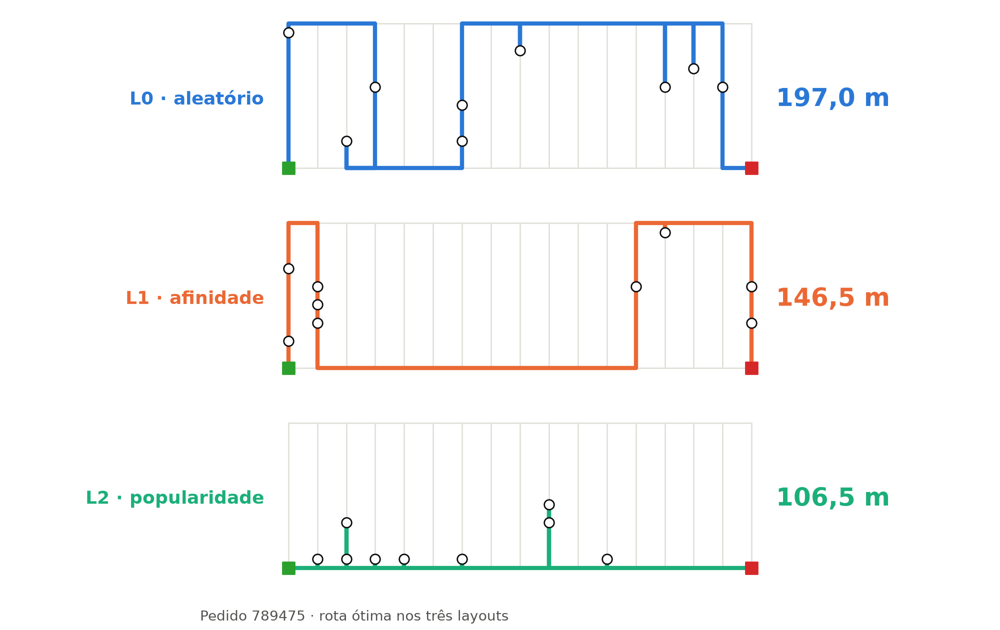

# Coleta Eficiente de Pedidos de Supermercado Online

Este é o projeto da disciplina SMAC03 – Grafos (UNIFEI, 2026.2) para o **Cenário 5**, cujo objetivo é reduzir o percurso do funcionário que coleta pedidos de supermercado online. A loja é modelada como um grafo ponderado, e o percurso de coleta é comparado em **3 layouts × 4 estratégias × 100 pedidos reais** do [Instacart Market Basket Analysis](https://www.kaggle.com/datasets/psparks/instacart-market-basket-analysis), num total de 1.200 rotas.

- Relatório: [`relatorio/Grupo_8_Coleta_eficiente_de_pedidos_em_supermercado_online.pdf`](relatorio/Grupo_8_Coleta_eficiente_de_pedidos_em_supermercado_online.pdf)
- Slides: [`slides/Coleta_de_pedidos_em_supermercado_online_slides.pdf`](slides/Coleta_de_pedidos_em_supermercado_online_slides.pdf)

**Em resumo:** quando as seções mais pedidas ficam perto da entrada e do caixa (layout L2) e o funcionário segue a rota de custo mínimo, o percurso médio cai de 313,4 m para 118,4 m e a capacidade sobe de 48 para 72 pedidos por turno de 8 h.

---

## Sumário

- [Contexto](#contexto)
- [Ideia](#ideia)
- [O que foi desenvolvido](#o-que-foi-desenvolvido)
- [Resultados](#resultados)
- [Como rodar](#como-rodar)
- [Estrutura do projeto](#estrutura-do-projeto)
- [Tecnologias](#tecnologias)
- [Equipe](#equipe)

---

## Contexto

Num supermercado online, um funcionário percorre a loja para separar os itens de cada pedido antes da entrega. O tempo dessa coleta depende de duas decisões: onde cada seção fica na loja (o layout) e em que ordem o funcionário visita as seções do pedido (a estratégia de coleta).

O trabalho mede quanto cada uma dessas decisões reduz a distância percorrida e o tempo de coleta e, com isso, quantos pedidos cabem em um turno.

Como o Instacart não traz a planta da loja, a geometria (corredores, slots e passagens) é uma premissa do grupo. Os pedidos, as seções e a afinidade entre seções vêm do dataset real.

## Ideia

A loja é modelada como um grafo, e cada pedido vira um problema de rota.

- **Grafo físico G₁:** reúne 134 slots de prateleira em 17 corredores, a ENTRADA, o CAIXA e os pontos de passagem, com arestas pesadas pela distância em metros (Manhattan). A troca de corredor só acontece pela frente ou pelo fundo da loja, e o Dijkstra gera a matriz D (136 × 136), que serve para medir qualquer rota.
- **Rota de um pedido:** sai da ENTRADA, faz uma parada em cada seção do pedido e termina no CAIXA. É um caixeiro viajante com origem e destino fixos, e o custo é a soma das distâncias de D.

Sobre esse grafo, comparam-se três layouts:

| Layout | Como é gerado |
|---|---|
| **L0** | seções em posições aleatórias (referência) |
| **L1** (grafo multicamadas) | a camada lógica G₂ liga seções compradas juntas (peso = lift) e uma busca local aproxima as seções afins |
| **L2** (grafo único) | as seções mais pedidas ficam nos slots de menor deslocamento entre ENTRADA e CAIXA |

Também se comparam quatro estratégias de coleta:

| Estratégia | Ordem de visita |
|---|---|
| `ordem_carrinho` | ordem em que o cliente colocou as seções no carrinho (referência) |
| `corredores` | varredura em S, com os corredores em ordem crescente e o sentido alternado |
| `vizinho` | sempre a seção mais próxima ainda não visitada |
| `custoMin` | rota de custo mínimo, com Held-Karp até 15 seções e 2-opt acima disso |

Os indicadores são a distância (m), o tempo T = D/v + 15 s por item + 120 s por pedido (v = 1 m/s), os pedidos por turno de 8 h e o ganho sobre a ordem do carrinho. Os intervalos de confiança de 95% vêm de um bootstrap pareado com 10.000 reamostragens.

O trabalho testa quatro hipóteses:

- **H1:** L1 e L2 andam menos que L0.
- **H2:** L1 anda menos que L2.
- **H3:** as estratégias ganham da ordem do carrinho, `custoMin` nunca perde para as outras e o ganho cresce com o número de seções.
- **H4:** com uma seção só, as quatro estratégias empatam.

## O que foi desenvolvido

O protótipo está em notebooks Jupyter. `grafo.ipynb` e `rotas.ipynb` formam a base e são carregados pelos demais com `%run`, para que todos usem o mesmo modelo.

| Componente | O que faz |
|---|---|
| [`src/grafo.ipynb`](src/grafo.ipynb) | Define a geometria e os tempos, monta o grafo físico G₁, calcula a matriz D com Dijkstra, lê os layouts e os 100 pedidos e monta a camada lógica G₂, em que há aresta quando duas seções aparecem juntas em pelo menos `n_min` pedidos do histórico e o peso é o lift. |
| [`src/rotas.ipynb`](src/rotas.ipynb) | Implementa as quatro estratégias. `custoMin` usa Held-Karp (programação dinâmica, exata) até 15 seções. Acima disso, aplica 2-opt a partir de `vizinho` e de `corredores` e fica com a rota menor. |
| [`src/layouts.ipynb`](src/layouts.ipynb) | Gera L1 por busca local, trocando seções de lugar enquanto o custo ponderado pelo lift diminui, e L2 por popularidade. Também refaz a calibração de `n_min` nos 1.000 pedidos de validação. |
| [`src/testes.ipynb`](src/testes.ipynb) | Confere a matriz D (tamanho, simetria, distâncias calculadas à mão e desigualdade triangular), os layouts, os pedidos e o Held-Karp contra a força bruta. Também valida a geometria contra a calibração da modelagem. |
| [`src/experimento.ipynb`](src/experimento.ipynb) | Roda as 1.200 rotas, calcula distância, tempo, pedidos por turno e ganho com IC de 95%, verifica H1 a H4 e faz a análise de sensibilidade dos tempos. |
| [`src/demo.ipynb`](src/demo.ipynb) | Mostra a rota de um pedido em um layout, com a distância, o tempo e o ganho de cada estratégia. |
| [`figuras/figuras.ipynb`](figuras/figuras.ipynb) | Gera as figuras dos resultados e das rotas, em PNG e em GIF animado. |
| [`notebooks/curadoria_dados_cenario5_final.ipynb`](notebooks/curadoria_dados_cenario5_final.ipynb) | Lê o Instacart, confere a qualidade dos dados e gera as tabelas curadas e os itens dos pedidos de avaliação na ordem do carrinho. |
| [`modelagem/`](modelagem/) | Reúne os scripts das modeladoras, que geram as imagens dos layouts e as figuras do grafo multicamadas e do grafo único. |

## Resultados

Os valores abaixo se referem aos 100 pedidos de avaliação. Eles foram gerados por `src/experimento.ipynb`, que os salva em `resultados/`.

### Distância média por pedido (m)

| Layout | `ordem_carrinho` | `corredores` | `vizinho` | `custoMin` |
|---|---:|---:|---:|---:|
| L0 | 313,4 | 160,2 | 165,3 | 155,6 |
| L1 | 334,3 | 147,5 | 151,4 | 144,1 |
| L2 | 263,9 | 118,9 | 135,4 | **118,4** |

### Pedidos por turno de 8 h

| Layout | `ordem_carrinho` | `corredores` | `vizinho` | `custoMin` |
|---|---:|---:|---:|---:|
| L0 | 48,4 | 65,2 | 64,4 | 65,8 |
| L1 | 46,7 | 67,1 | 66,5 | 67,6 |
| L2 | 52,8 | 71,9 | 69,0 | **72,0** |

### Hipóteses

| Hipótese | Resultado | Evidência |
|---|---|---|
| H1: L1 e L2 andam menos que L0 | **L2: confirmada. L1: mista** | L2 reduz de 15,8% a 25,8% contra L0 nas quatro estratégias. L1 reduz de 7,4% a 8,4% com `corredores`, `vizinho` e `custoMin`, mas anda 6,7% a mais com `ordem_carrinho`. |
| H2: L1 anda menos que L2 | **contrariada** | L1 anda de 11,9% a 26,7% a mais que L2 em todas as estratégias. |
| H3: as estratégias ganham do carrinho | **confirmada** | O ganho médio vai de 38,2% a 45,8%, e `custoMin` não perde para nenhuma outra estratégia em nenhum pedido. O ganho cresce com o número de seções, de 3–7% com 1–2 seções a 57–69% com 16 ou mais. |
| H4: com uma seção, as estratégias empatam | **confirmada** | Nenhum pedido de uma seção teve distâncias diferentes entre as estratégias. |



### Outras verificações

- **Validação da geometria:** nos 1.000 pedidos de validação, a distância média recalculada difere da calibração da modelagem em 0,010 m (L0) e −0,019 m (L1).
- **Calibração de `n_min`:** o valor adotado é 300, com G₂ conexo e 7.850 arestas, porque deu a menor distância média na validação (`dados/amostras/calibracao_n_min.csv`).
- **Sensibilidade:** com v ∈ {0,8; 1,0; 1,1} m/s, tempo por item ∈ {10, 15, 20} s e tempo fixo ∈ {60, 120, 180} s, a ordem dos 12 casos (layout × estratégia) se mantém nas 27 combinações, e só o número de pedidos por turno muda.
- **Pedidos heurísticos:** 8 dos 100 pedidos têm mais de 15 seções, e neles `custoMin` usa 2-opt em vez de Held-Karp.

## Como rodar

### Pré-requisitos

- Python 3 (os notebooks foram executados com Python 3.13 e 3.14)
- `pip`

### Instalação

Todos os comandos rodam na **raiz do repositório**.

```
pip install -r requirements.txt
```

Os dados curados, as amostras de pedidos e os layouts já estão em `dados/`, então o experimento roda sem baixar o Instacart.

### Execução

```
jupyter notebook
```

Os notebooks devem ser executados nesta ordem:

1. `src/layouts.ipynb` regera L1 e L2 a partir dos dados curados e refaz a calibração de `n_min`, que leva cerca de 3 min. L0 e as amostras de pedidos vêm da modelagem e são lidos de `dados/`.
2. `src/testes.ipynb` confere o grafo, as estratégias e a geometria e salva `resultados/validacao_geometria.csv`.
3. `src/experimento.ipynb` roda as 1.200 rotas e salva as tabelas em `resultados/`.
4. `src/demo.ipynb` mostra a rota de um pedido. Basta trocar `PEDIDO` e `LAYOUT`, e o padrão é o pedido `789475` em `L0`.
5. `figuras/figuras.ipynb` gera as figuras a partir das tabelas do passo 3.

### Curadoria (opcional)

A curadoria só precisa ser executada para refazer `dados/curados/`. Ela lê os CSVs de `dados/instacart/` e, se não os encontrar, baixa o dataset com o `mlcroissant`:

```
pip install mlcroissant
```

Os CSVs originais (`orders.csv`, `order_products__prior.csv`, `order_products__train.csv`, `products.csv`, `aisles.csv` e `departments.csv`) não são versionados.

### Figuras da modelagem (opcional)

As imagens dos layouts estão em `dados/layouts/`, e as do grafo multicamadas e do grafo único estão em `modelagem/` (`cenario1_grafo_multicamadas.png` e `cenario2_grafo_unico.png`). Como os notebooks não geram essas imagens, elas são reproduzidas com os scripts abaixo:

```
python modelagem/gerar_imagens_layouts.py
python modelagem/gerar_grafos_modelagem.py
```

`gerar_grafos_modelagem.py` aceita `--cenario 1`, `--cenario 2` e `--layout L0`, e neste último caso o arquivo ganha o sufixo `_L0`.

## Estrutura do projeto

```
├── src/
│   ├── grafo.ipynb          # grafo G1, Dijkstra, matriz D, layouts, pedidos e camada G2
│   ├── rotas.ipynb          # estratégias de coleta (Held-Karp e 2-opt)
│   ├── layouts.ipynb        # gera L1 (busca local) e L2 (popularidade) e refaz a calibração de n_min
│   ├── testes.ipynb         # testes do grafo e das rotas e validação da geometria
│   ├── experimento.ipynb    # 1.200 rotas, tabelas, hipóteses e sensibilidade
│   └── demo.ipynb           # rota de um pedido em um layout
├── figuras/
│   ├── figuras.ipynb        # figuras dos resultados e das rotas (relatório e slides)
│   ├── fig1_*, fig2_*, fig3_*, fig4_*   # distância, redução entre layouts, ganho por nº de seções e sensibilidade (PNG)
│   └── rotas_*.png          # rotas de um pedido por estratégia e por layout
├── modelagem/
│   ├── gerar_imagens_layouts.py   # imagens dos layouts L0, L1 e L2 (salvas em dados/layouts/)
│   ├── gerar_grafos_modelagem.py  # figuras do grafo multicamadas e do grafo único (salvas em modelagem/)
│   └── *.png                      # grafo multicamadas, grafo único e grafo físico
├── notebooks/
│   └── curadoria_dados_cenario5_final.ipynb   # curadoria do Instacart usada pelos notebooks
├── dados/                   # ver dados/README.md
│   ├── instacart/           # CSVs originais do Kaggle (não versionados)
│   ├── curados/             # catálogo, frequências e coocorrências das seções e dos departamentos, produtos mais pedidos e pedidos do train
│   ├── amostras/            # 100 pedidos de avaliação, itens desses pedidos na ordem do carrinho, 1.000 de validação e calibração de n_min
│   └── layouts/             # L0, L1 e L2 (CSV e imagem)
├── resultados/              # tabelas do experimento e da validação (CSV)
├── relatorio/               # relatório
├── slides/                  # apresentação (.pptx)
└── requirements.txt         # dependências
```

## Tecnologias

O projeto usa **Python** em notebooks **Jupyter**, com estas bibliotecas:

- **numpy** e **pandas**, no grafo, nas rotas, no experimento e nas tabelas;
- **matplotlib**, nas figuras dos resultados e da curadoria;
- **networkx**, nas figuras do grafo multicamadas (`modelagem/gerar_grafos_modelagem.py`);
- **mlcroissant** (opcional), para baixar o Instacart na curadoria.

Os algoritmos usados são Dijkstra (caminhos mínimos), Held-Karp (caixeiro viajante exato), 2-opt e vizinho mais próximo (heurísticas de rota), busca local (layout L1) e bootstrap pareado (intervalos de confiança).

## Equipe

| Papel | Integrante |
|---|---|
| Coordenadora | Fernanda Raponi Silva |
| Modeladora A | Jennifer Lopes |
| Modeladora B | Yasmin Araujo Da Silva |
| Desenvolvedora A | Júlia Garcia da Silva |
| Desenvolvedor B | Fábio Lourenço Machado Rodrigues |
